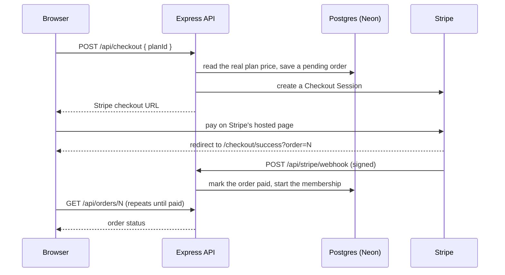

# Stride Fitness

A full-stack fitness studio website. Visitors browse programs and membership plans from a live database, create an account, pay for a plan with Stripe Checkout, and manage their membership from a personal dashboard.

- **Live site:** https://fitness-studio-delta-self.vercel.app
- **API:** https://fitness-studio-9ins.onrender.com

> Payments run in Stripe **test mode**. No real money moves. Use the test card listed under [Testing payments](#testing-payments).
> The free hosting tiers sleep when idle, so the first request after a quiet spell can take up to a minute.

## Features

- Programs and plans served from a Postgres database through a REST API
- Email and password sign-up and sign-in, with sessions that survive a page refresh
- Stripe Checkout (test mode) with a signed webhook, the only thing that can mark an order as paid
- Order records with a snapshot of the plan name and price at the time of purchase
- Member dashboard showing the current plan and account details
- Payment confirmation page that waits for the webhook before showing the order as paid
- Responsive layout with an accessible mobile menu, loading, error and retry states for every request

## Tech stack

| Layer | Technology |
| --- | --- |
| Client | React, Vite, Tailwind CSS v4, React Router, React Toastify |
| Server | Node.js 22, Express 5 (ES modules) |
| Database | Postgres on Neon |
| Authentication | Better Auth (email and password, sessions stored in Postgres) |
| Payments | Stripe Checkout and webhooks (test mode) |
| Hosting | Vercel (client), Render (server) |

## How it fits together

The browser only ever talks to the Vercel address. Vercel forwards every `/api/...` request to the Render server, which talks to Neon and Stripe. Because the browser sees one address, the login cookie stays first-party and is sent with every request. In development, Vite's proxy forwards `/api` to `localhost:4000` and does the same job.

### The payment flow



## Project structure

```
stride-fitness/
  client/
    src/
      components/    Navbar, Hero, Programs, HowItWorks, Plans, Join, Footer, AuthModal, ApiStatus
      context/       AuthDialog (the shared sign-in pop-up)
      hooks/         useFetch (loading, error and retry handling)
      lib/           auth-client (Better Auth client)
      pages/         Dashboard, CheckoutSuccess
      App.jsx        routes: /, /dashboard, /checkout/success
    vercel.json      forwards /api to Render, serves the app for every page
  server/
    sql/schema.sql   the database tables
    src/
      index.js       app setup and route mounting
      auth.js        Better Auth configuration
      db.js          Postgres connection pool
      stripe.js      Stripe client
      migrate.js     applies sql/schema.sql
      seed.js        fills programs and plans (safe to run again)
      middleware/    requireUser (login check)
      routes/        programs, plans, membership, checkout, orders, stripeWebhook
```

The repository also contains the original HTML and CSS version of the site.

## Database

| Table | Purpose |
| --- | --- |
| `programs` | Training programs shown on the home page |
| `plans` | Membership plans and monthly prices (whole dollars) |
| `plan_features` | The bullet points listed under each plan |
| `leads` | Email addresses for the Join form |
| `memberships` | The plan each member is on, one row per member |
| `orders` | One row per purchase: user, status, total in cents, Stripe session id |
| `order_items` | What each order contains, with the plan name and price copied in at purchase time |
| `user`, `account`, `session`, `verification` | Created by Better Auth for login |

Key rules enforced by the schema:

- `memberships.user_id` is unique, so a member can only be on one plan at a time.
- `orders.status` is `pending`, `paid` or `expired`, and only the Stripe webhook moves an order to `paid`.
- A plan that has members cannot be deleted, and a user who has orders cannot be deleted.
- `order_items` stores the price that was charged, so changing a plan's price later does not rewrite history.

`memberships` and `orders` reference Better Auth's `user` table, so the auth tables must exist before `sql/schema.sql` is applied.

## API

| Method and path | Access | Description |
| --- | --- | --- |
| `GET /api/health` | public | Server status check |
| `GET /api/programs` | public | List programs |
| `GET /api/plans` | public | List plans with their features |
| `/api/auth/*` | public | Sign up, sign in, sign out, session (Better Auth) |
| `GET /api/me` | public | The signed-in user, or `null` |
| `GET /api/membership` | signed in | The member's current plan, or `null` |
| `POST /api/checkout` | signed in | Body `{ "planId": 2 }`. Saves a pending order and returns a Stripe checkout URL |
| `GET /api/orders/:id` | signed in | One of the member's own orders, with its items |
| `POST /api/stripe/webhook` | Stripe only | Verifies Stripe's signature, then marks the order paid and starts the membership |

## Getting started

### Prerequisites

- Node.js 22 or newer
- A [Neon](https://neon.tech) Postgres database
- A [Stripe](https://stripe.com) account in a sandbox or test environment, and the [Stripe CLI](https://docs.stripe.com/stripe-cli)

### Configure the server

Create `server/.env`. It is git-ignored, and `server/.env.example` lists the names.

```
DATABASE_URL=             your Neon connection string
CLIENT_URL=http://localhost:5173
BETTER_AUTH_URL=http://localhost:5173
BETTER_AUTH_SECRET=       a long random string
STRIPE_SECRET_KEY=        sk_test_... from the Stripe dashboard
STRIPE_WEBHOOK_SECRET=    whsec_... printed by "stripe listen" (see below)
DB_OVER_WEBSOCKET=true    optional, local only (see below)
```

`BETTER_AUTH_URL` is `http://localhost:5173` in development because the browser talks to Vite, which proxies `/api` to the server.

### Install and set up the database

```
cd stride-fitness/server
npm install
npx auth@latest migrate --config src/auth.js   # login tables, first time only
npm run db:migrate                             # application tables
npm run db:seed                                # programs and plans
```

`npm run db:test` checks the database connection.

### Run it

Use three terminals.

```
# 1. API on http://localhost:4000
cd stride-fitness/server
npm run dev

# 2. Client on http://localhost:5173
cd stride-fitness/client
npm install
npm run dev

# 3. Stripe CLI, which forwards webhooks to the local server
stripe login
stripe listen --events checkout.session.completed,checkout.session.expired --forward-to localhost:4000/api/stripe/webhook
```

`stripe listen` prints a signing secret starting with `whsec_`. Put it in `server/.env` as `STRIPE_WEBHOOK_SECRET` and restart the server.

### If your network blocks port 5432

Some networks block the standard Postgres port. Setting `DB_OVER_WEBSOCKET=true` in `server/.env` makes the server reach Neon over a WebSocket on port 443 instead, using Neon's serverless driver. This is for local development only: leave it unset on Render, and remove it on a network that allows port 5432.

## Testing payments

Everything uses Stripe's test mode. At the checkout page, pay with:

| Field | Value |
| --- | --- |
| Card number | `4242 4242 4242 4242` |
| Expiry | any future date |
| CVC | any three digits |
| Name, email, postal code | anything |

After paying you should land on a confirmation page that shows **Payment received**, and the dashboard should show the plan you bought. Stripe's dashboard shows each webhook delivery and the status code the server returned.

## Deployment

**Render (server):** root directory `stride-fitness/server`, build command `npm install`, start command `npm start`. Environment variables: `DATABASE_URL`, `CLIENT_URL`, `BETTER_AUTH_URL`, `BETTER_AUTH_SECRET`, `STRIPE_SECRET_KEY`, `STRIPE_WEBHOOK_SECRET`. Set `CLIENT_URL` and `BETTER_AUTH_URL` to the Vercel address with no trailing slash. Do not set `DB_OVER_WEBSOCKET`.

**Vercel (client):** root directory `stride-fitness/client`. `vercel.json` forwards `/api` to the Render URL and serves the app for every other path, so refreshing `/dashboard` works.

**Stripe webhook:** in the Stripe dashboard, add an event destination of type webhook endpoint for `checkout.session.completed` and `checkout.session.expired`. Point it at the Render address directly, `https://<your-service>.onrender.com/api/stripe/webhook`, and use that destination's signing secret as `STRIPE_WEBHOOK_SECRET` on Render. The secret printed by `stripe listen` is a different one and belongs only in your local `.env`.

## Security notes

- Secrets live only in `.env` locally and in Render's environment settings. They are never committed.
- Passwords are hashed by Better Auth and never stored in plain text.
- Prices are read from the database on the server. The browser only sends a plan id.
- The webhook verifies Stripe's signature against the raw request body, checks that the order is pending and that the amount matches, and ignores repeated deliveries.
- A membership only starts through a paid order. There is no route that lets a member set their own plan.
- Orders can only be read by the member who placed them.
- Database queries use placeholders, so user input cannot change the SQL.
- The API only accepts requests from the site's own address.

## Known limitations

- Payments run in test mode only. Going live would need a Stripe account activated for real payments, live keys and a live webhook endpoint.
- A purchase is a one-time payment for the first month. There is no recurring billing or cancellation yet.
- The Join form is not yet connected to the `leads` table.
- No email verification or password reset yet.
- On free hosting, Render and Neon sleep when idle, so the first request after a quiet spell can be slow.

## Author

Built by Ayo as a practicum project.
